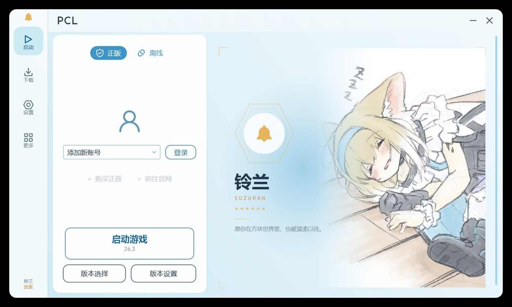

# PCL 铃兰修改版（Suzuran Launcher）

> 第三方基于 [Plain Craft Launcher 2](https://github.com/Hex-Dragon/PCL2) 独立进行的二次创作，**不是 PCL 官方版本**，与原作者之间不存在隶属或授权关系。

一个以「明日方舟 · 铃兰」为主题的 PCL 界面重构版：左侧图标栏 + 悬浮白色卡片 + 冰蓝配色，启动页内置铃兰插画。

## 下载

- **直接下载**：[PCL-Suzuran-v2.99.0.1.zip](https://github.com/xurishengbinggua/suzuran-launcher/releases/download/v2.99.0.1/PCL-Suzuran-v2.99.0.1.zip)
- **全部版本**：[Releases](https://github.com/xurishengbinggua/suzuran-launcher/releases)

解压后运行 `Plain Craft Launcher 2.exe` 即可，无需安装，首次启动会自动创建目录，不影响已有存档。

## 功能

- 启动页铃兰主题视觉，插画可自行替换或关闭
- 下载页完整解锁：原版游戏、Mod、整合包、数据包、资源包、光影包
- 微软正版登录开箱即用（已内置通过 Mojang 审核的 Client ID）
- 窗口默认尺寸 1000 × 600

## 常见问题（FAQ）

### 登录相关

**Q1. 点「正版登录」弹出「需要配置微软登录」怎么办？**

说明程序目录下的 `PCL\MsClientId.txt` 不存在或里面没有 ID。最常见的原因是**只替换了 exe，没有带上数据文件**。

解决：重新解压完整的发布包；或手动在该文件里写一行你的 Client ID（GUID），然后**完全退出 PCL（含托盘图标）**再启动。

**Q2. 提示「当前使用的 Client ID 尚未通过 Minecraft 服务审核」？**

说明你填入的是自己新注册、但还没过审的 Client ID。到 <https://aka.ms/mce-reviewappid> 提交审核，通过后即可登录。

本程序**内置的 ID 已经过审**，正常使用不会出现这条提示。

**Q3. 提示「当前 IP 的登录尝试异常」？**

这是微软对短时间大量登录请求的风控，通常和 VPN、加速器、机房 IP 有关。关掉代理或更换节点，等待 10 分钟再试。

如果日志里看到 `Invalid app registration`，那不是 IP 问题，请参考 Q2。

**Q4. 登录卡在「微软登录步骤 4/6」？**

第 4 步是向 Mojang 换取游戏凭证，失败原因看 `PCL\Log1.txt`：

| 日志里的错误 | 原因 | 处理 |
|---|---|---|
| `Invalid app registration` | Client ID 未通过 Mojang 审核 | 见 Q2 |
| `Forbidden (403)` 无上述字段 | IP 被风控 | 见 Q3 |
| `Too Many Requests (429)` | 请求过于频繁 | 等 10 分钟 |
| `Service Unavailable (503)` | Mojang 服务器故障 | 稍后再试 |

**Q5. 报错 `AADSTS900144: The request body must contain the following parameter: 'client_id'`？**

Client ID 为空，和 Q1 是同一个原因。

**Q6. 报错 `AADSTS700016`？**

应用 ID 在该租户不存在，或应用的账户类型不支持个人微软账号。重新注册应用时，账户类型要选「任何组织目录中的账户和个人 Microsoft 账户」。

**Q7. 登录后提示「你尚未购买正版 Minecraft，或者 Xbox Game Pass 已到期」？**

该微软账号确实没有 Minecraft: Java Edition 的所有权。请购买正版或在微软账号上绑定有效的 Game Pass。启动器不会绕过正版验证。

**Q8. 提示「请先创建 Minecraft 玩家档案」？**

这个微软账号还没设置 Java 版用户名。点提示里的按钮前往 minecraft.net 创建档案，然后重新登录。

**Q9. 提示「登录尝试太过频繁」？**

等待 10–15 分钟，期间不要反复点击登录。

**Q10. 登录成功后，下次还要输入代码吗？**

不需要。登录令牌保存在本机，除非更换电脑或清除了 PCL 配置。

### 使用相关

**Q11. 启动页没有铃兰插画？**

检查程序目录下是否存在 `PCL\Suzuran\main.jpg`（或 `.png` / `.jpeg`）。文件名和扩展名必须匹配，改完需重启程序。

**Q12. 怎么更换或关闭插画？**

把图片命名为 `main.jpg` 放进 `PCL\Suzuran\` 覆盖原文件即可；删除该目录下的 `main.*` 文件则恢复纯文字首页。

**Q13. 下载游戏需要登录吗？**

不需要。下载页的原版游戏、Mod、整合包、数据包、资源包、光影包全部开放。

**Q14. 下载速度很慢？**

在 设置 → 下载 中切换下载源，或使用加速器。下载失败时优先尝试官方源以外的镜像。

**Q15. 界面颜色变了，能换回冰蓝吗？**

设置 → 个性化 → 颜色。注意本改版依据 PCL 分发许可，界面主要色相需要保持蓝色。

**Q16. 支持 macOS 或 Linux 吗？**

不支持。PCL 基于 WPF，只能在 Windows 10 / 11 上运行，需要 .NET Framework 4.8（Windows 10 1903 及以上已自带）。

**Q17. 杀毒软件报毒？**

程序为开源项目编译产物，且未做代码签名，部分杀软会误报。可以自行用源码编译，或把程序目录加入信任。请只从本仓库的 Releases 下载。

**Q18. 更新版本会丢失存档和设置吗？**

不会。存档在 `.minecraft` 目录，设置在 `PCL` 目录，更新时只替换程序文件即可。但**不要删除 `PCL\MsClientId.txt`**，否则正版登录会失效。

**Q19. 日志在哪里？**

`PCL\Log1.txt`。反馈问题时请附上该文件，并说明出错时点了什么按钮。

### 其他

**Q20. 这个和官方 PCL 是什么关系？**

第三方二次创作，非官方版本，与原作者无从属关系。项目遵循《PCL 分发有限许可》与《PCL 存储库合理使用指南》，源码公开。

**Q21. 会收集我的隐私吗？**

不会。详见 [PRIVACY.md](PRIVACY.md)。账号令牌只保存在本机，不会上传。

**Q22. 启动页插画可以商用吗？**

插画由使用者提供，版权归原画师所有，仅作个人界面装饰。公开分发前请自行确认授权；无法确认时请删除 `PCL\Suzuran\main.jpg`。

## 反馈问题

请到 [Issues](https://github.com/xurishengbinggua/suzuran-launcher/issues) 提交，并附上：

1. 系统版本（如 Windows 11 23H2）
2. 操作步骤与现象
3. `PCL\Log1.txt` 中出错时间点附近的日志

## 微软正版登录是怎么工作的

本程序使用 Microsoft 标识平台的官方 OAuth 2.0 设备授权流：

1. 用户在启动器内点击「正版登录」；
2. 启动器向 `https://login.microsoftonline.com/consumers/oauth2/v2.0/devicecode` 申请一次性代码；
3. 用户在 `https://www.microsoft.com/link` 输入代码并在微软官方页面完成授权；
4. 启动器用返回的令牌依次换取 Xbox Live、XSTS 令牌，再调用 `api.minecraftservices.com`：
   - `/entitlements/mcstore` 校验该账号是否拥有 Minecraft: Java Edition；
   - `/minecraft/profile` 获取 Java 版档案（UUID、用户名）；
   - `/authentication/login_with_xbox` 获取启动游戏所需的凭证。

开发者不接触用户的微软账号密码；访问令牌与刷新令牌只保存在用户本机。

## 隐私

见 [PRIVACY.md](PRIVACY.md)。简言之：不收集、不上传、不出售任何个人信息，令牌只存在本机。

## 许可与署名

- 原作者：龙腾猫跃（Hex-Dragon）· <https://github.com/Hex-Dragon/PCL2>
- 赞助原作者：<https://meloong.com/afd/a/LTCat>
- 本改版作者：guapi
- 本仓库继续沿用《PCL 分发有限许可》与《PCL 存储库合理使用指南》，全文见 [LICENSE](LICENSE)

本改版为重度使用情形，已按要求：

1. 明确标注为第三方二次创作；
2. 软件名称以 Plain Craft Launcher (PCL) 开头并带第三方修改后缀；
3. 在关于页首位署名原作者并提供赞助链接，公开源代码，继续使用原许可文件；
4. 保留 Minecraft 正版购买劝导；
5. 界面主要色相保持为蓝色，不提供类似赞助解锁的功能。

## 免责声明

请支持正版 Minecraft。本项目仅供学习与个人使用，与 Mojang Studios、Microsoft 无任何关联；Minecraft 是 Mojang Studios 的商标。

---

## For Minecraft Services reviewers

Suzuran Launcher is a free, open-source, non-commercial third-party launcher for **Minecraft: Java Edition**, built as a UI-focused derivative of the open-source **Plain Craft Launcher 2** project. It is distributed publicly at no cost and does not sell or bundle the game.

It uses the official Microsoft identity platform with the **OAuth 2.0 device authorization grant as a public client** (no client secret). After the user signs in with their own Microsoft account, tokens are exchanged through Xbox Live and XSTS, and `api.minecraftservices.com` is called only to:

1. verify that the signed-in account owns Minecraft: Java Edition (`/entitlements/mcstore`);
2. retrieve the account's Java profile (`/minecraft/profile`);
3. obtain launch credentials for the user's own account (`/authentication/login_with_xbox`).

The developer does not collect Microsoft credentials. Access and refresh tokens are stored only on the user's own device and are used only to keep the user signed in. The launcher does not bypass Microsoft authentication, does not grant Minecraft entitlements to accounts that do not own the game, and does not modify or redistribute game files.

A single public Client ID is shared by all users of the launcher, which is why one AppID approval is requested.

Contact: <https://github.com/xurishengbinggua/suzuran-launcher/issues>
